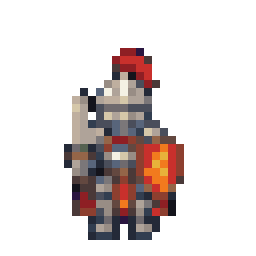

# Cavaleiro — nova pose de frente

Criado em 26/11/2026. Versão separada do cavaleiro anterior, aguardando aprovação de Raffel/Henrique.

[Baixar sprite 32×32](../../art/personagens/cavaleiro-frente-v2.png) · [Abrir prévia 8×](../../art/personagens/cavaleiro-frente-v2.preview8x.png) · [Original gerado](../../art/rascunho/cavaleiro-frente-v2.png) · [Prompt completo](../../art/rascunho/cavaleiro-frente-v2.prompt.md)

IA: OpenAI, ferramenta nativa image_gen. O identificador específico do modelo não é exposto pela ferramenta. Referência anexada: vila-aprovada.jpg. Rota: image-reference-workflow; entrega de um quadro base para aprovação, conforme item A da lista de imagens.

Conversão: tools/pixelize.py com quadro 32×32, corpo 16×24, fundo magenta removido e paleta da vila. Checagem de arte: 74 arquivos, 0 erros.

Veredito visual do agente: prata, vermelho, capacete, espada e escudo distinguíveis. O leão dourado do original perde definição na redução e vira uma marca dourada simplificada; essa limitação precisa ser avaliada pelo dono antes de continuar. Não há aprovação do usuário registrada para esta versão. Nenhuma tentativa rejeitada nesta leva.

As outras direções e animações dependem da aprovação da pose base. O sprite ainda não foi integrado ao jogo.

Verificação completa: tools/verificar.py --captura terminou com TUDO CERTO. Captura do lobby aberta e conferida; a nova pose ainda não aparece nele porque aguarda aprovação antes da integração. A prévia do sprite foi aberta e comparada com a vila. O cartão Markdown foi conferido nos arquivos; a renderização no app Workspace não foi testada.
